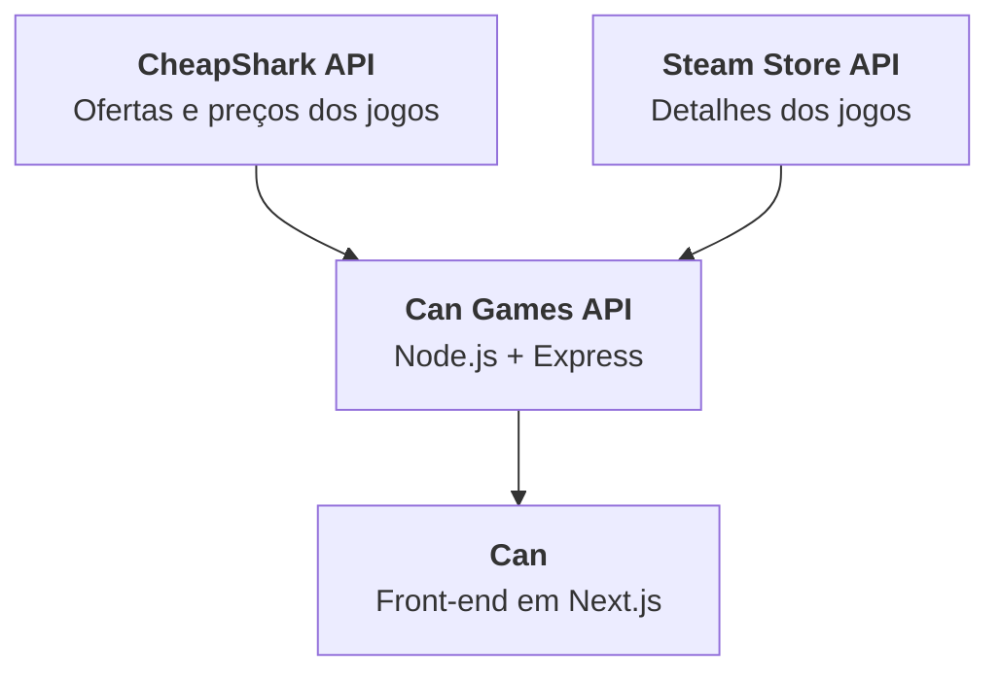

# Can

A **Can** é uma loja e biblioteca de jogos para a web, inspirada na Steam e desenvolvida em TypeScript com Next.js e React. Ela consome a [Can Games API](https://github.com/Ana72Lu/can-api), que reúne as ofertas da [CheapShark](https://www.cheapshark.com/api) e os dados da [Steam Store](https://store.steampowered.com/api), e apresenta o catálogo com preços em reais, pesquisa, filtros por gênero e uma página de detalhes para cada jogo.

Além da navegação pelo catálogo, o front-end oferece cadastro e autenticação de usuários, lista de desejos, carrinho, finalização simulada de compras e biblioteca com os jogos adquiridos. A interface segue um manual de identidade visual próprio, de fundo escuro, e foi projetada para atender ao nível AA da WCAG em computadores e dispositivos móveis.

🔗 **Acesse a Can:** [https://can.arisesystem.com.br/](https://can.arisesystem.com.br/)

---

## 🎮 Funcionalidades

- Vitrine da loja com destaques em carrossel, ofertas especiais, atalhos por gênero e abas de catálogo (Recomendados, Até R$ 20 e De R$ 20 a R$ 50).
- Pesquisa de jogos com sugestões durante a digitação e página de resultados com ordenação e filtros por preço, promoção e gênero.
- Páginas de gênero com os recortes Tudo, Maiores descontos e Menor preço, pesquisa na lista e filtros.
- Página de detalhes de cada jogo, com galeria de capturas de tela, descrição, requisitos de sistema, idiomas, recursos (inclusive os de acessibilidade), classificação indicativa e jogos semelhantes.
- Cadastro, login, logout, edição do perfil e exclusão da conta.
- Lista de desejos com pesquisa, filtros, ordenação e reordenação por arraste ou por botões.
- Carrinho e finalização simulada da compra em três etapas (carrinho, pagamento e confirmação), com cinco formas de pagamento.
- Biblioteca com os jogos adquiridos, em grade ou em lista, com pesquisa, filtros e botão "Jogar". Os jogos adicionados na última semana e ainda não executados recebem o selo "Novo".
- Validação dos formulários, tratamento das respostas e dos erros da API e estados de carregamento.

---

## 🛠️ Tecnologias

| Tecnologia | Utilização |
|---|---|
| Next.js 16 (App Router e Turbopack) | Rotas, renderização das páginas no servidor e otimização de imagens e fontes |
| React 19 | Componentes e estado da interface |
| TypeScript 5 | Tipagem do código e dos dados recebidos da API |
| Tailwind CSS 4 | Estilização, com as cores, as fontes e as sombras do manual em `src/app/globals.css` |
| Lucide (`lucide-react`) | Ícones |
| `next/font` (Google Fonts) | Carregamento das fontes Rajdhani e Roboto, servidas pelo próprio site |
| ESLint 9 (`eslint-config-next`) | Análise do código |
| Node.js 20.9+ e npm | Ambiente de execução do servidor do Next.js e gerenciamento das dependências |
| Can Games API | Dados dos jogos, contas, carrinho, lista de desejos, biblioteca e pedidos |
| Docker | Execução do front-end e da API em contêineres no servidor de produção |
| Portainer | Gerenciamento dos contêineres no servidor |
| Cloudflare Tunnel (`cloudflared`) | Publicação do front-end e da API na internet, com HTTPS |

### Execução local

A execução local do projeto utiliza dois servidores:

| Servidor | Endereço | Inicialização |
|---|---|---|
| Front-end (Next.js) | `http://localhost:3000` | `npm run dev` neste repositório |
| Can Games API (Node.js + Express) | `http://localhost:4000` | `npm run dev` no repositório [`can-api`](https://github.com/Ana72Lu/can-api) |

O front-end localiza a API pela variável de ambiente `NEXT_PUBLIC_API_URL`, definida no arquivo `.env.local`. Na ausência dessa variável, é utilizado o endereço `http://localhost:4000/api`.

Como a API armazena os dados em memória, as contas cadastradas são perdidas sempre que o servidor da API é reiniciado.

### Servidor de produção

Em produção, o front-end e a API são executados em contêineres Docker em um servidor caseiro, gerenciados pelo Portainer. A publicação na internet é feita pelo Cloudflare Tunnel: o `cloudflared`, em execução no servidor, mantém uma conexão de saída com a Cloudflare, que entrega o site aos usuários com HTTPS. Dessa forma, não é necessário abrir portas no roteador nem expor o endereço IP do servidor.

| Contêiner | Imagem | Função |
|---|---|---|
| `front` | `Dockerfile` deste repositório | Front-end em Next.js, no modo `standalone`, na porta 3000. |
| `api` | `Dockerfile` do repositório `can-api` | Can Games API, na porta 4000. |
| `cloudflared` | `cloudflare/cloudflared` | Túnel que publica o front-end e a API na internet. |

O navegador acessa o front-end e a API pelos endereços públicos do túnel. Já o servidor do Next.js se comunica com a API pela rede interna do Docker (`http://api:4000/api`). As instruções estão na seção [Deploy no servidor](#-deploy-no-servidor).

---

## 🎨 Decisões de design

A Can segue um manual de identidade visual próprio, com fundo escuro, como as lojas de jogos para computador. O fundo escuro deixa em destaque as capas coloridas dos jogos. As cores, as fontes e as sombras do manual estão em `src/app/globals.css`, e o site utiliza somente esses valores.

### Logo e nome


Em inglês, *can* significa "lata" e também "poder".

A logo é uma lata genérica, sem marca nem rótulo. Assim como uma lata pode ser o que o fabricante quiser para atender ao seu público, a Can pode ser o que o usuário quiser, com os jogos que ele escolher. O usuário tem esse poder, essa potência de ser: por isso, o nome une o *can* de lata ao *can* de poder.

A lata aparece aberta e inclinada, desenhada em linhas brancas sobre um círculo roxo, a cor principal do site. No cabeçalho e no rodapé, ela fica ao lado do nome "Can", escrito com a fonte dos títulos. A mesma ideia aparece nas telas de login e de cadastro, em que latas de refrigerante se transformam em foguetes.

### Tipografia

O site utiliza duas fontes **sem serifa**. As fontes com serifa, que têm pequenos traços nas pontas das letras, lembram textos impressos e transmitem um estilo mais tradicional. As fontes sem serifa têm um desenho mais limpo, são mais fáceis de ler na tela, principalmente em tamanhos pequenos, e transmitem um estilo moderno, que combina com jogos.

- **Rajdhani**, nos títulos: letras de formas retas e quase quadradas, com aparência tecnológica.
- **Roboto**, nos demais textos: fonte neutra, criada para telas, que continua legível em tamanhos pequenos.

| Nome | Família | Tamanho | Peso | Altura de linha |
|---|---|---|---|---|
| `xxxx-large` | Rajdhani | 48 px | 600 | 1,2 |
| `xxx-large` | Rajdhani | 40 px | 600 | 1,2 |
| `xx-large` | Rajdhani | 32 px | 600 | 1,2 |
| `x-large` | Rajdhani | 24 px | 600 | 1,2 |
| `large` | Roboto | 20 px | 400 e 500 | 1,5 |
| `medium` | Roboto | 16 px | 400 e 500 | 1,5 |
| `small` | Roboto | 14 px | 400 e 500 | 1,5 |

O peso 500 da Roboto é utilizado em botões, preços e destaques. A altura de linha de 1,5 facilita a leitura dos textos (critério 1.4.8 da WCAG, nível AAA).

### Iconografia

Os ícones seguem o estilo **linear** e **flat**: são desenhados com traços, sem sombra, volume ou efeito 3D. Eles vêm da biblioteca Lucide, têm a mesma espessura de traço em todo o site e aparecem em três tamanhos: 16, 20 e 24 px. O estilo linear é leve, combina com as fontes sem serifa e não disputa a atenção com as capas dos jogos.

Os ícones **preenchidos** aparecem em apenas dois casos, para indicar um estado ou destacar uma ação:

- O coração fica preenchido quando o jogo está na lista de desejos.
- O botão "Jogar", da biblioteca, utiliza o ícone de play preenchido.

Os ícones ao lado de um texto são decorativos e ficam ocultos para os leitores de tela. Os botões formados apenas por um ícone têm um nome, como "Menu" ou "Fechar". Quando um jogo não tem capa, o ícone de um controle aparece no lugar da imagem.

### Cores

**Primária (roxo):** a mesma cor da logo, utilizada em botões principais, abas e itens selecionados.

| Uso | Hex | Token |
|---|---|---|
| Principal | `#7C3AED` | `--color-primary` |
| Hover | `#5B21B6` | `--color-primary-hover` |
| Foco e links | `#A78BFA` | `--color-primary-focus` |

**Secundárias:** cada cor tem uma função fixa.

| Uso | Hex | Token |
|---|---|---|
| Chamada para ação: comprar, finalizar e desconto | `#10B981` | `--color-cta` |
| Marcadores (tags) e selo "Novo" | `#06B6D4` | `--color-tag` |
| Ações destrutivas, como a exclusão da conta | `#EF4444` | `--color-destructive` |

**Neutras:** utilizadas nos fundos, nas bordas e nos textos.

| Uso | Hex | Token |
|---|---|---|
| Fundo base | `#090D16` | `--color-background-base` |
| Fundo geral | `#0F172A` | `--color-background` |
| Painéis e navegação | `#131B2E` | `--color-panel` |
| Cards | `#1E293B` | `--color-card` |
| Bordas decorativas | `#334155` | `--color-border` |
| Títulos | `#F8FAFC` | `--color-title` |
| Subtítulos e placeholders | `#94A3B8` | `--color-subtitle` e `--color-placeholder` |
| Texto desativado | `#64748B` | `--color-disabled` |

**Ajustes de acessibilidade:** três combinações do manual não tinham o contraste exigido pelo nível AA. Para corrigi-las, foram criadas três cores, tiradas das mesmas escalas:

| Uso | Hex | Token | Contraste |
|---|---|---|---|
| Texto sobre o verde, o vermelho e o ciano | `#090D16` | `--color-on-accent` | De 5,16:1 a 8:1 |
| Mensagens de erro | `#F87171` | `--color-error-text` | 5,29:1 sobre o card |
| Borda dos campos de formulário | `#64748B` | `--color-border-input` | 3,07:1 sobre o card |

### Acessibilidade (WCAG 2.2, nível AA)

- **Contraste:** todos os textos têm contraste de pelo menos 4,5:1, e as bordas dos campos e o contorno de foco têm pelo menos 3:1.
- **Teclado:** todo o site funciona sem mouse, e o foco fica sempre visível, com um contorno roxo-claro. O primeiro Tab mostra o link "Pular para o conteúdo principal", e a tecla Esc fecha o menu, as sugestões da pesquisa e a galeria ampliada.
- **Leitores de tela:** as páginas informam o idioma e têm regiões e títulos organizados. Avisos como "foi adicionado ao carrinho" são anunciados pelos leitores de tela.
- **Formulários:** os campos têm rótulo visível, os obrigatórios são marcados com asterisco, e as mensagens de erro explicam como corrigir. Os detalhes estão na seção [Formulários](#formulários).
- **Movimento:** o carrossel não troca os destaques sozinho, e as animações são desligadas quando o usuário pede menos movimento nas configurações do sistema.
- **Ações irreversíveis:** a exclusão da conta pede confirmação.

Resultados do Lighthouse 13 no build de produção local (`npm run build` e `npm start`), obtidos em 09/11/2026 com a API em execução:

| Tela | Acessibilidade | Boas práticas | SEO | Desempenho em dispositivos móveis | Desempenho em computadores |
|---|---|---|---|---|---|
| Loja (`/`) | 100 | 100 | 100 | 79 | 100 |
| Jogo (`/games/[gameId]`) | 100 | 100 | 100 | 84 | 100 |
| Gênero (`/genres/[genreId]`) | 100 | 100 | 100 | 85 | 100 |
| Busca (`/search`) | 100 | 100 | 100 | 98 | 100 |
| Carrinho (`/cart`) | 100 | 100 | 100 | 99 | 100 |
| Lista de desejos (`/wishlist`) | 100 | 100 | 100 | 96 | 100 |
| Biblioteca (`/library`) | 100 | 100 | 100 | 98 | 100 |
| Finalizar compra (`/checkout`) | 100 | 100 | 100 | 96 | 100 |
| Perfil (`/profile`) | 100 | 100 | 100 | 98 | 100 |
| Entrar (`/login`) | 100 | 100 | 100 | 98 | 100 |
| Criar conta (`/signup`) | 100 | 100 | 100 | 97 | 100 |

As notas de acessibilidade, boas práticas e SEO são as mesmas em dispositivos móveis e em computadores. Em dispositivos móveis, o desempenho é menor nas telas com imagens grandes da Steam, porque o Lighthouse simula uma conexão 4G lenta.

O Lighthouse abre as telas sem login, então as telas que exigem conta foram avaliadas com o convite para entrar. Para avaliar também o que o usuário vê depois do login, todas as telas foram verificadas com o axe-core, com uma conta que tinha jogos no carrinho, na lista de desejos e na biblioteca. A verificação utilizou as regras da WCAG 2.0, 2.1 e 2.2 (níveis A e AA), nas larguras de 1366 px e 320 px, e não encontrou nenhuma violação.

### Responsividade

- **Abordagem:** o layout foi feito primeiro para o celular e se adapta às telas maiores a partir de 640, 768 e 1024 px.
- **Dispositivos móveis:** a navegação fica no botão "Menu", e os filtros ficam em um painel que abre e fecha. As listas e os formulários ocupam uma única coluna, sem rolagem horizontal mesmo com 320 px de largura (critério 1.4.10).
- **Computadores:** a navegação aparece completa no cabeçalho, e os filtros ficam ao lado da lista. A página do jogo é dividida em duas colunas, e os jogos aparecem em grades.

---

## 📁 Estrutura do projeto

```text
can/
├── design/
│   └── brand/              # Originais da logo e do ícone (não são servidos pelo site)
├── src/
│   ├── app/                # Rotas (uma pasta por tela), layout, estilos globais e ícones do site
│   ├── assets/brand/       # Emblema da lata utilizado pelo componente Logo
│   ├── components/
│   │   ├── account/        # Estados das páginas que exigem autenticação
│   │   ├── auth/           # Login e cadastro
│   │   ├── cart/           # Carrinho
│   │   ├── catalog/        # Pesquisa, páginas de gênero e filtros
│   │   ├── checkout/       # Etapas da compra e formas de pagamento
│   │   ├── forms/          # Campos e elementos de formulário reutilizáveis
│   │   ├── game/           # Capa, preço, cápsula, cartão e linha de jogo
│   │   ├── game-details/   # Seções da página do jogo
│   │   ├── home/           # Seções da loja
│   │   ├── layout/         # Cabeçalho, rodapé, menu e logo
│   │   ├── library/        # Biblioteca
│   │   ├── profile/        # Perfil e dados da conta
│   │   ├── store/          # Barra da loja e pesquisa com sugestões
│   │   ├── ui/             # Elementos genéricos: avatar, trilha de navegação, cabeçalho de seção e painel
│   │   └── wishlist/       # Lista de desejos
│   ├── data/               # Lista de gêneros e token da sessão
│   ├── hooks/              # Sessão, coleções, formulários e abas
│   ├── lib/                # Regras de negócio: preços, filtros, ordenação, datas e validação
│   ├── services/           # Requisições à API e conversão dos dados
│   └── types/              # Tipos dos dados da API e da interface
├── .dockerignore           # Arquivos que ficam fora da imagem Docker
├── .env.example            # Modelo da variável NEXT_PUBLIC_API_URL
├── .gitignore
├── AGENTS.md               # Manual de identidade visual e convenções do código
├── docker-compose.yml      # Stack de produção: front-end, API e Cloudflare Tunnel
├── Dockerfile              # Imagem de produção do front-end
├── eslint.config.mjs
├── next.config.ts          # Configuração do Next.js: modo standalone e imagens da Steam
├── package.json
├── package-lock.json
├── postcss.config.mjs
└── tsconfig.json
```

---

## 🏗️ Arquitetura e Integrações

A Can Games API consulta duas fontes externas e combina os dados recebidos. O front-end da Can consome os dados da API:



No front-end, a API é consumida a partir de dois pontos:

- **Servidor do Next.js:** gera as páginas do catálogo e mantém as listas de jogos em cache por 10 minutos.
- **Navegador:** realiza as consultas da pesquisa durante a digitação e as operações que dependem da conta do usuário, enviando o token JWT no cabeçalho `Authorization`.

### Camadas

O código está organizado nas três camadas apresentadas na disciplina:

| Camada | Pastas | Responsabilidade |
|---|---|---|
| Apresentação | `src/app/`, `src/components/` e `src/hooks/` | Telas, componentes e hooks React. |
| Negócio | `src/services/` e `src/lib/` | Requisições à API e regras de preços, filtros, ordenação, datas e validação. |
| Dados | Can Games API e `src/data/` | Origem dos dados. A pasta `src/data/` contém apenas a lista de gêneros e o token da sessão. |

Os componentes não acessam a API diretamente: todas as requisições passam por `src/services/`. O módulo `apiClient.ts` monta as requisições, envia o token e converte qualquer falha em um `ApiError`, com a mensagem retornada pela própria API. O módulo `gameMapper.ts` converte o formato da API para os tipos utilizados pela interface.

---

## 📋 Telas, componentes, interações, API e formulários

### Telas

| Rota | Tela | Conteúdo |
|---|---|---|
| `/` | Loja | Destaques, ofertas especiais, gêneros e abas do catálogo. |
| `/search` | Busca | Resultados da pesquisa pelo nome do jogo, com ordenação e filtros. |
| `/genres/[genreId]` | Gênero | Títulos populares e lista do gênero, com recortes, pesquisa e filtros. |
| `/games/[gameId]` | Jogo | Capturas de tela, preço, compra, descrição, requisitos, idiomas, recursos, classificação e jogos semelhantes. |
| `/login` | Entrar | Formulário de login. |
| `/signup` | Criar conta | Formulário de cadastro. |
| `/profile` | Perfil | Resumo da conta, estantes da biblioteca e da lista de desejos, edição dos dados e exclusão da conta. |
| `/wishlist` | Lista de desejos | Jogos salvos, com pesquisa, filtros, ordenação e reordenação. |
| `/cart` | Carrinho | Jogos selecionados, valor total e acesso à finalização da compra. |
| `/checkout` | Finalizar compra | Etapas da compra, forma de pagamento e confirmação do pedido. |
| `/library` | Biblioteca | Jogos adquiridos, em grade ou em lista, com pesquisa, filtros e botão "Jogar". |
| Qualquer rota inexistente | Página não encontrada | Aviso de erro 404 e link de retorno à loja. |
| Qualquer tela do catálogo | Erro ao carregar | Aviso de falha na comunicação com a API, com um botão para tentar novamente. |

As telas de perfil, lista de desejos, carrinho, finalização de compra e biblioteca exigem autenticação. Sem login, essas telas exibem um convite para entrar ou criar uma conta e, após a autenticação, o usuário retorna à mesma página.

### Componentes reutilizáveis

| Componente | Descrição | Utilização |
|---|---|---|
| `GameCover` | Capa do jogo ou ícone de controle quando não há imagem. | 11 componentes, entre eles cápsulas, cartões, linhas de jogo, carrinho, biblioteca e pesquisa. |
| `PriceTag` | Preço com desconto, "Gratuito" ou "Preço indisponível". | 9 componentes, da pesquisa à página do jogo. |
| `GameCapsule` | Cápsula que se expande com o mouse ou o foco e exibe uma captura de tela, os gêneros e os marcadores. | Ofertas especiais e títulos populares. |
| `GameCard` | Cartão com capa, nome e preço. | Jogos semelhantes e estantes do perfil. |
| `GameListItem` | Linha de jogo para listas longas. | Abas da loja e resultados da pesquisa. |
| `SectionHeader` | Título de seção com descrição opcional. | 11 seções da loja, da página do jogo e do perfil. |
| `SidePanel` | Painel lateral com título. | Idiomas, recursos, acessibilidade e classificação do jogo. |
| `Breadcrumb` | Trilha de navegação. | Páginas do jogo e do gênero. |
| `Avatar` | Iniciais do nome do usuário. | Cabeçalho, perfil, biblioteca e lista de desejos. |
| `CatalogFiltersPanel` | Filtros de preço máximo, promoção e gêneros. | Pesquisa e páginas de gênero. |
| `CollectionPageState` | Estados de carregamento, ausência de login e erro. | Carrinho, lista de desejos, biblioteca e finalização da compra. |
| `TextField` e `PasswordField` | Campo com rótulo e mensagem de erro; no campo de senha, inclui o botão "Mostrar senha". | Login, cadastro e perfil. |
| `SelectField` e `SearchField` | Lista de opções e campo de pesquisa. | Pesquisa, gêneros, lista de desejos e biblioteca. |
| `SubmitButton` | Botão de envio com estado de carregamento. | Login, cadastro, perfil e finalização da compra. |
| `ErrorSummary` | Resumo dos erros do formulário, com links para cada campo. | Login, cadastro, perfil e finalização da compra. |
| `Logo` | Emblema e nome da Can. | Cabeçalho e rodapé. |

**Hooks reutilizáveis:**

| Hook | Descrição |
|---|---|
| `useValidatedForm` | Gerencia valores, regras e erros de um formulário e move o foco para o resumo de erros no envio. |
| `useSession` | Informa a sessão atual: carregando, sem login ou autenticada. |
| `useGameCollection` | Informa o estado do carrinho, da lista de desejos ou da biblioteca. |
| `useCollectionGames` | Combina uma coleção com os dados dos jogos e informa se a tela está carregando, sem login, com erro ou pronta. |
| `useTabListNavigation` | Permite alternar as abas com as setas, Home e End. |

### Interações com o usuário

| Interação | Local | Funcionamento |
|---|---|---|
| Pesquisa com sugestões | Barra da loja | A partir de 2 letras, exibe até 5 jogos retornados pela API. As setas selecionam uma sugestão, o Enter abre o jogo selecionado ou a página de resultados, e o Esc fecha a lista. |
| Carrossel | Destaques da loja | Botões de anterior e próximo e um indicador por destaque. Não há troca automática. |
| Cápsulas expansíveis | Ofertas especiais e títulos populares | Com o mouse ou o foco, a cápsula exibe uma captura de tela, os gêneros e os marcadores. O Esc recolhe a cápsula. |
| Abas | Catálogo da loja e páginas de gênero | Alternam o conteúdo sem recarregar a página e funcionam com as setas do teclado. |
| Filtros e ordenação | Pesquisa, gêneros, lista de desejos e biblioteca | Preço máximo, somente promoções e gêneros, além da ordenação por critérios como maior desconto, menor preço e nome. |
| Galeria de capturas | Página do jogo | Navegação por miniaturas e pelas setas do teclado. A imagem pode ser ampliada em uma janela, que fecha com o Esc. |
| Menu para dispositivos móveis | Cabeçalho | O botão "Menu" abre e fecha a navegação. O Esc fecha o menu e devolve o foco ao botão. |
| Carrinho e lista de desejos | Página do jogo e lista de desejos | A alteração aparece imediatamente e é desfeita se a API recusar a operação. Após a adição, o botão é substituído pelo link "No carrinho". |
| Reordenação da lista de desejos | Lista de desejos | Por arraste ou pelos botões "Mover para cima" e "Mover para baixo". |
| Modo de exibição | Biblioteca | Alterna a exibição dos jogos entre grade e lista. |
| Jogar | Biblioteca | Registra a data da última execução e move o jogo para o topo da ordenação por atividade. |
| Compra em etapas | Finalizar compra | Exibe os jogos, solicita a forma de pagamento e confirma o pedido com o número e o valor total. |
| Mostrar senha | Login e cadastro | Exibe ou oculta a senha digitada. |
| Exclusão da conta | Perfil | Abre uma janela de confirmação antes da exclusão. |

### Métodos consumidos da API

Todas as requisições são realizadas pelos módulos de `src/services/`. Os endpoints seguem a mesma notação do README da API:

| Método | Endpoint | Finalidade | Função no front-end |
|---|---|---|---|
| `GET` | `/api/games` | Consultar o catálogo da loja, os gêneros, a pesquisa e as sugestões. | `getStoreCatalog`, `getGameShowcasesByGenre`, `searchStoreCatalog` e `suggestStoreGames` |
| `GET` | `/api/games/:identifier` | Consultar a página do jogo e os dados dos jogos das coleções. | `getGameDetails` e `getGamesByIds` |
| `GET` | `/api/cart`, `/api/wishlist` e `/api/library` | Carregar as coleções do usuário. | `reload` de cada coleção |
| `POST` | `/api/cart` e `/api/wishlist` | Adicionar um jogo. | `cartCollection.add` e `wishlistCollection.add` |
| `DELETE` | `/api/cart/:gameId` e `/api/wishlist/:gameId` | Remover um jogo. | `cartCollection.remove` e `wishlistCollection.remove` |
| `PATCH` | `/api/wishlist/:gameId` | Alterar a posição de um jogo na lista. | `wishlistCollection.move` |
| `PATCH` | `/api/library/:gameId` | Registrar a última execução de um jogo. | `launchGame` |
| `POST` | `/api/users` | Cadastrar uma conta. | `registerAccount` |
| `GET` | `/api/users/me` | Recuperar a sessão ao abrir o site. | `sessionStore` |
| `PATCH` | `/api/users/:id` | Atualizar o perfil. | `updateProfile` |
| `DELETE` | `/api/users/:id` | Excluir a conta. | `deleteAccount` |
| `POST` | `/api/sessions` | Realizar o login. | `signIn` |
| `DELETE` | `/api/sessions` | Encerrar a sessão. | `signOut` |
| `POST` | `/api/orders` | Finalizar a compra. | `placeOrder` |

**Tratamento de respostas e erros:**

- **Carregamento:** enquanto a API não responde, as telas exibem "Carregando..." e os botões de envio permanecem em estado de espera.
- **Erros da API:** a mensagem retornada pela API é exibida ao usuário. Quando a API recusa um campo, como um apelido ou e-mail já cadastrado, o erro é exibido no campo correspondente do formulário.
- **API indisponível:** sem resposta da API, é exibido o aviso "Não foi possível falar com o servidor da Can". No catálogo, é exibida a tela de erro, com o botão "Tentar de novo".
- **Sessão expirada:** quando a API responde com o status 401, o front-end encerra a sessão.
- **Carrinho e lista de desejos:** se a API recusar uma alteração, ela é desfeita na tela e um aviso explica o ocorrido.

### Formulários

| Formulário | Tela | Campos | Validação |
|---|---|---|---|
| Cadastro | `/signup` | Nome completo, apelido, data de nascimento, endereço, e-mail e senha (6 campos obrigatórios). | Regras descritas abaixo da tabela. |
| Login | `/login` | E-mail e senha. | Ambos os campos são obrigatórios, e o e-mail deve ser válido. Em caso de senha incorreta, o aviso da API é exibido no resumo de erros. |
| Edição do perfil | `/profile` | Nome completo, apelido, e-mail e endereço. | Mesmas regras do cadastro, inclusive o aviso de apelido ou e-mail já cadastrado. |
| Pagamento | `/checkout` | Forma de pagamento: cartão de crédito, cartão de débito, boleto, Pix ou depósito bancário. | Seleção obrigatória. |

**Regras do cadastro:**

- **Nome completo:** deve conter nome e sobrenome.
- **Apelido:** de 3 a 20 caracteres, com letras sem acento, números, `_` ou `-`.
- **Data de nascimento:** o usuário deve ter pelo menos 13 anos.
- **Endereço:** deve conter rua, número e cidade, com pelo menos 10 caracteres.
- **E-mail:** deve ser um endereço válido.
- **Senha:** pelo menos 8 caracteres, incluindo letras e números.

Se a API informar que o apelido ou o e-mail já estão em uso, o aviso é exibido no próprio campo.

**Padrão comum a todos os formulários:**

- Rótulo visível acima do campo e um exemplo no placeholder;
- `autocomplete` nos dados pessoais;
- Validação no envio (`noValidate`, com as regras em `src/lib/accountValidation.ts`);
- Foco no resumo de erros;
- `aria-invalid` e `aria-describedby` em cada campo com erro.

---

## 🚀 Instalação e execução local

### Pré-requisitos

- **Node.js:** versão 20.9 ou superior, exigida pelo Next.js 16.
- **npm:** instalado junto com o Node.js.
- **Git:** opcional, caso queira clonar o repositório.
- **Can Games API:** em execução, conforme as instruções do [README da API](https://github.com/Ana72Lu/can-api#readme).
- **Conexão com a internet:** necessária para que a API consulte a CheapShark e a Steam Store e para carregar as imagens dos jogos.

### 1. Iniciar a API

Siga as instruções do README da `can-api` até que `http://localhost:4000/health` retorne `status: "ok"`.

No `.env` da API, `FRONTEND_ORIGIN` deve incluir `http://localhost:3000`, valor já utilizado no exemplo do README da API. Caso contrário, o navegador bloqueia as requisições feitas pelo front-end.

### 2. Obter o projeto

Clone o repositório e entre na pasta:

```bash
git clone https://github.com/Wesley-Sousa-Dev/can.git
cd can
```

Se você baixou os arquivos ZIP, extraia-os e abra um terminal na pasta do projeto.

### 3. Instalar as dependências

```bash
npm install
```

### 4. Configurar as variáveis de ambiente

Se a API estiver em execução em `http://localhost:4000`, esta etapa é opcional, pois esse é o endereço padrão. Caso contrário, crie um arquivo `.env.local` na raiz do projeto, no mesmo nível do `package.json`, a partir do `.env.example`:

```env
NEXT_PUBLIC_API_URL=http://localhost:4000/api
```

O endereço deve terminar em `/api`. A configuração do servidor de produção está descrita na seção [Servidor de produção](#servidor-de-produção).

### 5. Iniciar o servidor

Modo de desenvolvimento, com atualização automática da página:

```bash
npm run dev
```

Build de produção:

```bash
npm run build
npm start
```

Por padrão, o front-end ficará disponível em `http://localhost:3000`.

Para utilizar a lista de desejos, o carrinho e a biblioteca, cadastre uma conta pelo próprio site.

**Atenção:** como a API armazena os dados em memória, é necessário cadastrar uma nova conta sempre que o servidor da API for reiniciado.

---

## 🐳 Deploy no servidor

O arquivo `docker-compose.yml` deste repositório constrói as imagens do front-end e da API e inicia os contêineres `front`, `api` e `cloudflared`. Nenhuma porta é publicada no servidor: o acesso externo é feito exclusivamente pelo túnel.

### Variáveis do stack

| Variável | Descrição | Exemplo |
|---|---|---|
| `PUBLIC_FRONTEND_URL` | Endereço público do site, sem barra no final. É repassado à API como `FRONTEND_ORIGIN`, para liberar o CORS. | `https://can.exemplo.com` |
| `PUBLIC_API_URL` | Endereço público da API, terminando em `/api`. | `https://can-api.exemplo.com/api` |
| `JWT_SECRET` | Segredo utilizado pela API para assinar os tokens. | Valor aleatório, gerado como no README da API |
| `TUNNEL_TOKEN` | Token do túnel, gerado no painel Zero Trust da Cloudflare. | — |
| `API_SOURCE` | Opcional. Origem do código da API. | Padrão: `https://github.com/Ana72Lu/can-api.git#main` |

**Atenção:** o Next.js grava as variáveis `NEXT_PUBLIC_` no código durante o build. Por isso, `PUBLIC_API_URL` é enviado como argumento do build da imagem do front-end (`NEXT_PUBLIC_API_URL`). Após alterar esse endereço, é necessário reconstruir a imagem; alterar apenas a variável do contêiner não tem efeito.

Os domínios devem ter um único nível abaixo do domínio principal, como `can-api.exemplo.com`. O certificado gratuito da Cloudflare não cobre endereços como `api.can.exemplo.com`.

### 1. Criar o túnel na Cloudflare

No painel Zero Trust da Cloudflare, crie um túnel do tipo `cloudflared` e copie o token exibido no comando de instalação. Em seguida, cadastre dois endereços públicos no túnel:

| Endereço público | Serviço |
|---|---|
| Domínio do site (ex.: `can.exemplo.com`) | `http://front:3000` |
| Domínio da API (ex.: `can-api.exemplo.com`) | `http://api:4000` |

Os nomes `front` e `api` correspondem aos serviços do `docker-compose.yml`. O `cloudflared` os localiza pela rede interna do stack.

### 2. Criar o stack no Portainer

1. Em *Stacks*, clique em *Add stack* e escolha o método *Repository*.
2. Informe o endereço deste repositório, a branch a ser publicada e o caminho `docker-compose.yml`.
3. Cadastre as variáveis do stack em *Environment variables*.
4. Clique em *Deploy the stack*. O Portainer constrói as imagens e inicia os três contêineres.

A imagem da API é construída a partir da branch `main` do repositório `can-api`, que deve conter o `Dockerfile` da API.

### Alternativa pelo terminal

O stack também pode ser iniciado diretamente no servidor, com os dois repositórios clonados lado a lado:

```bash
git clone https://github.com/Wesley-Sousa-Dev/can.git
git clone https://github.com/Ana72Lu/can-api.git
cd can
```

Crie um arquivo `.env` na pasta `can`, ao lado do `docker-compose.yml`:

```env
PUBLIC_FRONTEND_URL=https://can.exemplo.com
PUBLIC_API_URL=https://can-api.exemplo.com/api
JWT_SECRET=COLE_AQUI_UM_SEGREDO_FORTE
TUNNEL_TOKEN=COLE_AQUI_O_TOKEN_DO_TUNEL
API_SOURCE=../can-api
```

Em seguida, construa as imagens e inicie os contêineres:

```bash
docker compose up -d --build
```

Para publicar novos commits, use *Pull and redeploy* no stack do Portainer ou, pelo terminal, execute `git pull` nos dois repositórios e repita o comando acima. Como a API armazena os dados em memória, as contas são perdidas sempre que o contêiner da API é recriado.

---

## 📜 Comandos disponíveis

| Comando | Descrição |
|---|---|
| `npm install` | Instala as dependências do projeto. |
| `npm run dev` | Inicia o servidor de desenvolvimento em `http://localhost:3000`. |
| `npm run build` | Gera o build de produção e verifica os tipos. |
| `npm start` | Inicia o build de produção em `http://localhost:3000`. |
| `npm run lint` | Verifica problemas no código com ESLint. |
| `docker compose up -d --build` | Constrói as imagens e inicia o stack de produção no servidor. |
